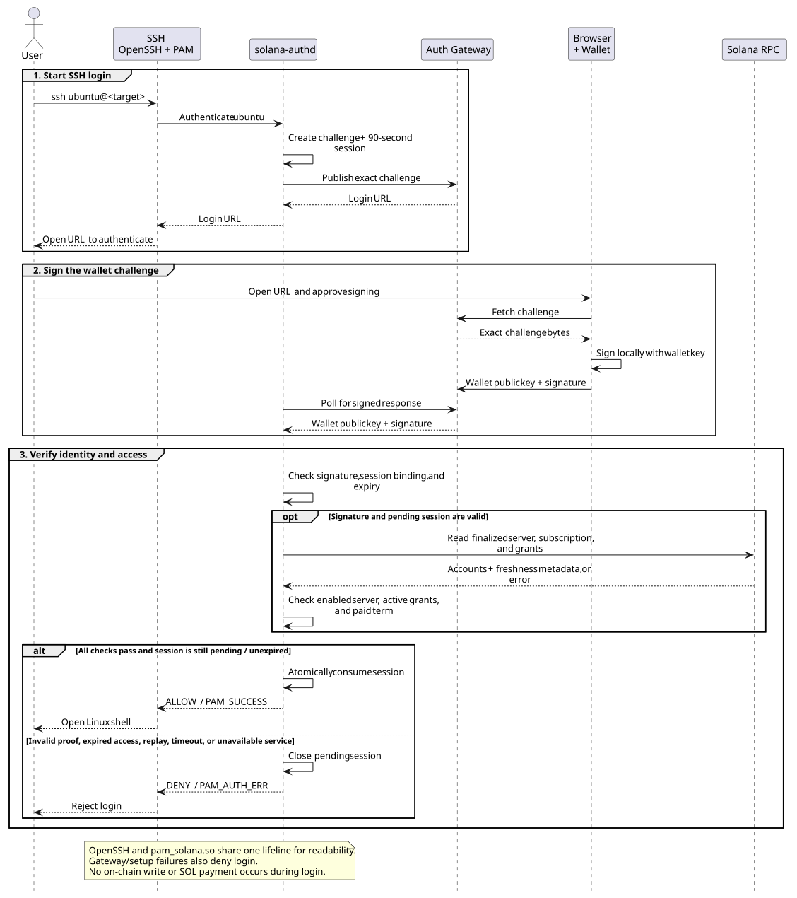
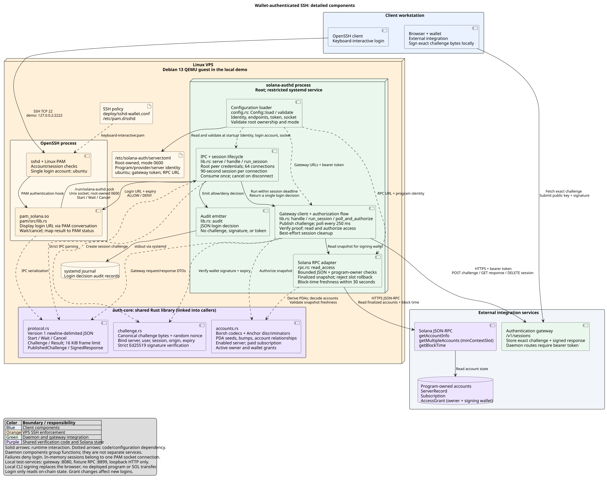

# Wallet-authenticated SSH

Rust implementations of `pam_solana.so` and `solana-authd`, with a Debian 13 QEMU
environment and TypeScript tests. PAM performs local IPC and displays a signing
prompt; the daemon verifies Ed25519 signatures and finalized Solana account state.
See [CONTRACTS.md](CONTRACTS.md) for wire formats.

The gateway and RPC in the test environment are **synthetic fixtures**. No program
is deployed, no SOL is transferred, and there is no browser wallet page. Account
encoding is provisional pending integration with the program owner. The daemon
has no fixture authorization bypass.

## Authentication flow

The diagram shows how OpenSSH/PAM, `solana-authd`, the auth gateway, the wallet,
and Solana RPC authenticate a login and verify access.



[PlantUML source](../docs/diagrams/ssh-login.puml) ·
[Rendering instructions](../docs/diagrams/README.md)

## Detailed component diagram

The diagram separates the client, VPS processes, shared `auth-core` library,
and external services. It shows PAM IPC, daemon session handling, gateway and
RPC interfaces, signature and account verification, configuration, and audit
output. The local VM uses `test-services` for the gateway and RPC, and a CLI
signer in place of a browser wallet.



[PlantUML source](../docs/diagrams/ssh-components.puml) ·
[Rendering instructions](../docs/diagrams/README.md)

## Prerequisites and checks

- Linux, QEMU (`qemu-system-x86_64`, `qemu-img`), OpenSSH client and `ssh-keygen`.
- Rust/Cargo 1.85+ and PAM development headers for host checks/signing tools.
- Node.js 22.18+ and npm. Tests and VM management use TypeScript; no Python scripts
  or Docker are required.
- Supplied image at `../tests/debian-13-nocloud-amd64.qcow2`.
- Available host ports `127.0.0.2:2222` and `:8899`; up to 16 GiB guest disk
  space. QEMU uses KVM when available and otherwise TCG. The gateway prefers
  port 8080 and automatically selects a free port if that port is occupied.

## Run the complete test pipeline

From `ssh/`, run:

```sh
npm run test:all
```

From the repository root, the equivalent command is
`npm --prefix ssh run test:all`. The runner is
[tests/pipeline.ts](tests/pipeline.ts), uses Node's built-in TypeScript support,
and installs its locked npm dependencies automatically; no separate `npm ci` is
needed for this command.

The pipeline executes these stages in order and stops at the first failure:

| Stage | Check or action |
| --- | --- |
| 1 | Install Node development dependencies with `npm ci --ignore-scripts`. |
| 2 | Check Rust formatting without rewriting source files. |
| 3 | Run workspace Clippy, including test targets, with warnings treated as errors. |
| 4 | Build host binaries, including the test wallet signer and PAM library. |
| 5 | Run all Rust unit tests and documentation tests. |
| 6 | Type-check the TypeScript runners, fixtures and SSH tests. |
| 7 | Stop this project's managed VM, check SSH/RPC ports, and select/save a free gateway port. |
| 8 | Run network regression tests and gateway contract tests with a temporary host fixture service. |
| 9 | Boot/provision Debian; build, test, format-check and lint Rust inside the guest. |
| 10 | Run the full SSH end-to-end suite against `127.0.0.2:2222`. |

The gateway tests and VM share the selected gateway port and `127.0.0.2:8899`,
so stage 7 also closes existing SSH/serial sessions to this test VM. The runner
does not stop unrelated processes or delete/reset the overlay. It reuses the
guest filesystem and Cargo cache, and preserves the supplied base image.

Successful runs leave the VM available for manual use. To stop it after success:

```sh
npm run test:all -- --stop-vm
```

This adds a final VM shutdown stage. On failure, later stages do not run and the
VM/overlay remain in the state reached, so you can investigate. Exit status is
zero only if every requested stage passes. `--help` describes the options.

No port override is needed for the usual command. Before gateway tests, the
pipeline tries the saved gateway port, or 8080 on the first run. If another service
owns that port, it asks the OS for a free port and prints its URL. The choice is
saved in `.vm/network.json`; later test and VM commands reuse it automatically.
The pipeline report also records the selected URL. Unrelated listeners stay running.

To require a specific gateway port:

```sh
export SOLANA_SSH_GATEWAY_PORT=18080
npm run test:all
```

An explicit `SOLANA_SSH_GATEWAY_PORT` takes precedence over the saved port. If it
is occupied, the pipeline fails at stage 7 with the address and a recovery hint;
it does not silently choose a different port. Unset the variable to enable automatic
selection again. The selected port applies to the host fixture listener, QEMU
forwarding, public signing origin and signing helper together. The guest daemon
still reaches its gateway on guest port 8080; host SSH/RPC remain 2222/8899.
Changing the port of an already-running VM requires stopping and preparing it
again; the full pipeline does this automatically. Standalone VM startup also
selects and saves its gateway port.

The SSH suite takes roughly two minutes with KVM, including a real 90-second
expiry test. Cold runs take longer to download packages and compile both host and
guest dependencies; TCG is slower. Network access is required for npm, Cargo and
Debian packages, and the runner needs permission to use loopback and Unix sockets.

Only one pipeline may run at a time. `.vm/pipeline.lock` records its host PID and
is removed on normal completion, failure or handled interruption. After a forced
kill, remove a stale lock only after confirming that PID is no longer running.
Ctrl-C stops the active host stage; a guest command already submitted through the
serial console may continue. `npm run vm -- stop` stops the VM when needed.

## Test layers and coverage

Counts below describe the current suites. Several tests exercise multiple input
cases, so the count is smaller than the number of authentication attempts.

| Layer | Tests | What it establishes |
| --- | ---: | --- |
| Rust `auth-core` | 4 | Canonical signed bytes, strict signature/server/account binding, expiry and clock rollback, field-injection rejection, owner/delegate rules, account encoding and freshness boundaries. |
| Rust `pam-solana` | 2 | Invalid PAM handles fail closed; incomplete or oversized daemon responses are rejected. |
| Rust `solana-authd` | 4 | Secure configuration defaults, RPC metadata rejection, bounded IPC parsing and single-use/monotonic session expiry. |
| TypeScript network regression | 3 | Automatic fallback when a wildcard listener occupies the preferred port, explicit override behavior, and saved-port reuse and validation. |
| TypeScript gateway contracts | 3 | Publication/retrieval, protected daemon operations, duplicate IDs/proofs, expiry, deletion and authenticated fixture controls. |
| TypeScript Debian/OpenSSH | 28 | Actual SSH authentication through the installed PAM module and daemon, including authorization, lifecycle failures and recovery. |

Rust tests live beside the implementation in `auth-core/src`, `pam/src` and
`solana-authd/src`. They run on the host and again with Debian's compiler and PAM
libraries. Formatting, Clippy and TypeScript checks are additional gates, not
included in the test counts.

### Gateway contract tests

[tests/gateway.test.ts](tests/gateway.test.ts) launches the Rust `test-services`
binary on the host. It verifies exact challenge retrieval, 401 responses for
unauthenticated daemon operations, pending-response polling, one immutable proof
per session, duplicate rejection, expiry and cleanup. The test service is stopped
after the suite. These tests need a built host binary but do not need the VM.

`npm test` also runs [tests/network.test.ts](tests/network.test.ts). Gateway startup
checks both listener addresses first, so a conflict names the occupied address
and provides a recovery command instead of only reporting fixture-process failures.

### Real SSH tests in Debian

[tests/ssh.test.ts](tests/ssh.test.ts) invokes the host's normal OpenSSH client.
An `SSH_ASKPASS` helper reads the actual PAM signing prompt, obtains the challenge,
uses a public fixture wallet to sign it, submits the proof and supplies Enter to
the prompt. Successful authentication must execute `id -un` and return `ubuntu`;
the tests pin the guest's SSH host key obtained over the recovery console.

Coverage includes:

- Owner/delegate logins, duplicate-proof rejection and independent concurrent sessions.
- Invalid signatures, another server/account's signed bytes, unauthorized wallets
  and attempts to reuse a consumed signature on a new connection.
- Expired subscriptions and owner/delegate grants; revoked grants and disabled servers.
- Wrong program ownership, discriminators, PDA bumps, server relationships or grant
  roles; missing accounts, regressed RPC contexts and owner changes between reads.
- Stale/future RPC block times and unavailable RPC; fresh fixture subscription state
  restoring login after expiry.
- Wrong Linux users, password/key bypass attempts (including an installed test
  authorized key), unprivileged Unix-socket peers and invalid IPC versions.
- Disconnects both at the signing prompt and while awaiting approval; daemon restart
  invalidating pending attempts; gateway/daemon outages and independent root-console recovery.
- An unsigned login expiring at the real 90-second deadline, with a bounded completion time.

The suite changes fixture scenarios and stops/restarts guest services, so run it
against the disposable test VM. It restores the normal fixture scenario/services
and removes transient challenge/proof files when its cleanup hook completes.

The VM disables OpenSSH source-address penalties so deliberately failed logins do
not suppress subsequent test cases. The deployment configuration retains normal
penalties. Authorization-denial tests require a displayed challenge and generated
proof, preventing an early connection refusal from counting as an authorization test.

These tests exercise real cryptography, IPC, PAM and OpenSSH against synthetic RPC
accounts and a fixture gateway. They do **not** validate a deployed Solana program,
payments, finality on a live cluster, browser wallets or production TLS. The
renewal scenario changes fixture state; it does not execute an on-chain payment.

## Run individual checks

For development, run only the layer relevant to your change. From `ssh/`:

```sh
cargo build --locked --workspace
cargo test --locked --workspace
cargo fmt --all -- --check
cargo clippy --locked --workspace --all-targets -- -D warnings
npm ci
npm run typecheck
npm run vm -- stop --if-running
npm test
npm run vm -- prepare
npm run test:vm
```

For focused reruns:

```sh
cargo test --locked -p auth-core
cargo test --locked -p solana-authd
cargo test --locked -p pam-solana
npm run test:vm -- --test-name-pattern=disconnect
npm run test:vm -- --test-name-pattern='fail closed'
```

The SSH name filter reduces test coverage; use `npm run test:all` for the complete
gate. After Rust or guest-configuration changes, rerun `npm run vm -- prepare`
before testing SSH so the guest uses the updated artifacts.

Standalone gateway tests use the same ports as the VM; run them before starting
it or after stopping it. First provisioning downloads Debian packages and Rust
crates; subsequent runs reuse the overlay and guest Cargo cache.

`prepare` handles the first-boot wizard through the serial console, grows the
overlay filesystem, builds and tests the workspace **inside Debian**, and installs
OpenSSH/PAM/systemd configuration. The supplied image is never modified. Failures
stop provisioning and preserve diagnostics. If QEMU's DNS relay fails, a guest-only
DNS fallback is used (1.1.1.1; override with `SOLANA_VM_DNS`).

## VM operation and recovery

```sh
ssh -p 2222 ubuntu@127.0.0.2
npm run vm -- console
npm run vm -- exec 'systemctl status solana-authd --no-pager'
npm run vm -- stop
npm run vm -- up
npm run vm -- reset
```

The recovery console is independent of PAM. Exit with Ctrl-]. Its generated root
password is in `.vm/secrets.json` (0600); never reuse it elsewhere. The harness
normally leaves an authenticated root shell on the private local console socket.
Recovery can restart the daemon or restore `/etc/pam.d/sshd.before-solana`.

`reset` stops this VM and removes its generated overlay/readiness state, preserving
the original image. `stop` preserves the overlay. Private control sockets live in
`/tmp` to accommodate long Unicode workspace paths.

Host SSH `127.0.0.2:2222` forwards to guest port 22. Gateway/RPC forwards use host
`127.0.0.2:<selected-gateway-port>` and `:8899`; the guest daemon uses
`127.0.0.1:8080` and `:8899`. Read `.vm/network.json` or the pipeline output for
the selected port. `SOLANA_SSH_GATEWAY_PORT` overrides it and the public signing URL.
The signing origin is bound into the challenge separately from the transport URL.

Test signing URLs return exact challenge JSON. For a manual terminal login, run
`target/debug/test-services sign '<displayed-url>' owner` in another terminal,
then press Enter in SSH. Use `delegate` for the other public fixture wallet.

## Results and troubleshooting

Generated artifacts are ignored under `.vm/`:

| Artifact | Purpose |
| --- | --- |
| `pipeline-report.json` | Latest started pipeline: timestamps, overall status, attempted stages, exact commands, durations and failure reason. Unreached stages are absent. |
| `pipeline.log` | Combined stdout/stderr and stage headings for the latest pipeline. |
| `network.json` | Selected host gateway port, reused by subsequent test and VM commands. |
| `report.json` | Latest SSH suite's scenario names, pass/fail results and durations. A filtered run contains only matching scenarios. |
| `serial.log` | Guest provisioning/build output and recovery-console commands. |
| `qemu.log` | QEMU startup/device errors. |
| `debian-overlay.qcow2` | Reusable guest changes and build cache; the base image remains separate. |
| `known_hosts`, `ready` | Pinned guest host key and successful preparation marker. |
| `secrets.json`, `bypass_key` | Private, disposable test credentials; never publish these. |

Use the pipeline's overall status to assess the full run. A failure before the SSH
stage leaves the previous `report.json` intact; its timestamp/results are not
evidence that the current pipeline passed. Preflight or lock failures occur before
any test stage and do not replace the previous pipeline report. Reports/logs are
replaced by subsequent runs, so copy non-secret diagnostics first if needed.

Common failure paths:

| Symptom | Next step |
| --- | --- |
| Missing image or executable | Check the prerequisites and image path; preflight exits before test stages. |
| Port already in use | Stop this project's VM with `npm run vm -- stop --if-running`. For gateway conflicts, unset `SOLANA_SSH_GATEWAY_PORT` and rerun `npm run test:all` for automatic selection, or choose a free explicit port. SSH/RPC ports 2222/8899 stay fixed; resolve conflicting listeners before retrying. |
| npm/Cargo download or guest DNS failure | Check network permissions and `pipeline.log`/`serial.log`; `SOLANA_VM_DNS` overrides the guest DNS fallback. |
| Guest build/provisioning fails | Read `serial.log`, fix the reported step, then rerun `npm run vm -- prepare` or the pipeline; the overlay is retained. |
| No signing prompt or unexpected denial | Check guest `sshd -t`, service state and journals over the recovery console. |
| A scenario fails | Inspect `report.json`; rerun its name with `--test-name-pattern` after restoring/preparing the VM. |

Useful diagnostics:

```sh
tail -n 80 .vm/pipeline.log
tail -n 80 .vm/serial.log
npm run vm -- exec 'systemctl status ssh solana-authd solana-test-services --no-pager'
npm run vm -- exec 'journalctl -u solana-authd -u ssh -n 80 --no-pager'
```

Daemon JSON audit events go to journald without challenge URLs, tokens, nonces or
signatures. Keep the serial console available when diagnosing authentication;
`npm run vm -- reset` is an optional clean start that discards the overlay, not a
required response to a failed test.

## Real integration

Use a deployed program/layout matching [CONTRACTS.md](CONTRACTS.md), a compatible
authenticated HTTPS gateway and a synchronized clock. Build on the target distro,
install the daemon/PAM library, and supply root-owned mode-0600
`/etc/solana-auth/server.toml` from [the sample](deploy/server.toml.example).

[The daemon unit](deploy/solana-authd.service) applies systemd restrictions.
[The SSH configuration](deploy/sshd-wallet.conf) is a single-account demo policy.
Keep Debian's account/session checks; replace its authentication stack with
`auth requisite pam_solana.so`. Run `sshd -t` and verify console recovery before
activating the policy. Never install the fixture service on a production server.
Grant changes affect new logins; existing SSH sessions remain established.
